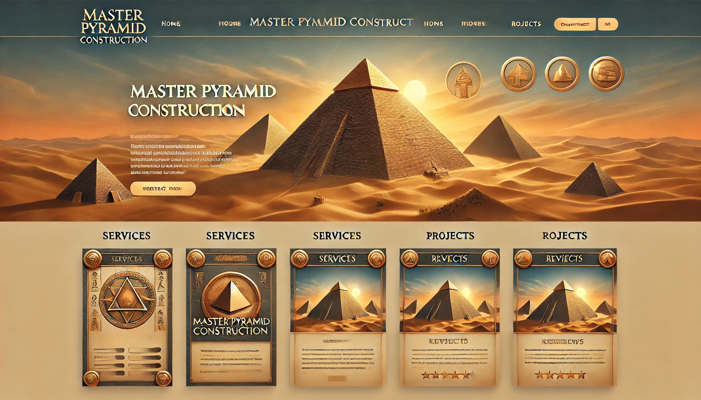

# Egyetemi beadandó weboldal

### 1. **Bemutatkozó oldal**

- **Felépítés**:
  - **Fejléc**: Fent egy nagy, teljes szélességű kép egy naplementés piramisról. A háttérben sivatag, homokdűnék és a lenyugvó nap meleg fényében fürdő piramis.
  - **Cím**: A kép közepére, nagy méretben, arany betűkkel kiírva: _"Piramisépítés mesterfokon"_. A betűtípus elegáns, de antik hatású, mondjuk Trajan vagy valami hasonló, ókori stílust idéző.
  - **Bemutatkozó szöveg**: A cím alatt egy rövid szöveg (max. 3 sor), amely kiemeli a vállalkozás egyediségét. Ez világos betűkkel van írva, hogy kontrasztos legyen a képhez.
  - **Piramis képek**: Ahogy a felhasználó görget lefelé, megjelennek különböző piramisokról készült képek, talán néhány éjszakai égboltos verzió is (csillagokkal), és alatta rövid szöveg (egy mondat arról, milyen nagyszerűek ezek a struktúrák).
- **Színek**: Meleg, természetes színek: arany, homokszín, sötétkék (éjszakai égbolt) és némi bordó. A háttér finom textúrájú, homokot idéző minta lehetne.
- **Dizájn**: Letisztult, minimalista, de minden eleme az ókor dicsőségét és a sivatagi hangulatot sugározza. 🏜️✨

### 2. **Szolgáltatások oldal**

- **Felépítés**:
  - **Fejléc**: Teljes szélességű, drónfelvétel-szerű kép egy épülő piramisról, emberekkel és darukkal a sivatagban.
  - **Szolgáltatások**: A felhasználó három nagy szekcióra bontva látja a szolgáltatásokat. Mindegyik szekció egy képpel indul (pl. egy hagyományos, modern és mini piramis), majd mellette rövid, lényegre törő leírás.
  - **Elrendezés**: Grid stílus, tehát 3 oszlopban vagy 3 vízszintes sávban jelennek meg a szolgáltatások. Amikor az egérrel a felhasználó egy-egy oszlop fölé megy, a kép kissé felnagyítódik, és a szöveg kiemelődik.
- **Színek**: Meleg sárgák, homokszínek, a piramis képei dominálnak. Az oszlopok háttere fehér vagy halvány bézs, hogy a képek és a szövegek élesebben kitűnjenek.
- **Dizájn**: Antik motívumok itt-ott (pl. az oszlopok között vékony, hieroglifákat idéző vonalak). Minden könnyen áttekinthető és interaktív hatást kelt. 🏗️🏛️

### 3. **Árak oldal**

- **Felépítés**:
  - **Fejléc**: Egy minimalista fejléc kép piramis építésről, de sziluett-szerűen, hogy ne vonja el a figyelmet a táblázatról.
  - **Ártáblázat**: A központi elem egy nagy, átlátható táblázat, amely tartalmazza a különböző piramistípusokat és azok áraival együtt. A táblázat sorai különböző színekben váltakoznak (pl. halvány homokszín és világos szürke), hogy jobban elkülönüljenek.
  - **Kiemelt árak**: Az exkluzív szolgáltatások (pl. titkos kamra, extra díszítés) külön, feltűnő módon vannak kiemelve egy dobozban az oldal jobb oldalán.
- **Színek**: Semleges, világos tónusok (homokszín, halvány sárga, fehér) a tiszta, professzionális megjelenés érdekében.
- **Dizájn**: Letisztult, modern árlista, de egy-egy hieroglifa vagy antik motívum a sorok között finoman emlékeztet az ókori tematikára. 📊💰

### 4. **Kapcsolat oldal**

- **Felépítés**:
  - **Fejléc**: Egy nagy, sivatagos háttérkép (piramis a távolban, homokdűnék az előtérben). A kép tetején áttetsző overlay, hogy a kontakt űrlap kiemelkedjen.
  - **Kapcsolati űrlap**: Egyszerű form: név, e-mail cím, üzenetmező. Mindez középre rendezve, hogy ne vigye el a felhasználó figyelmét. Alatta a _"Küldés"_ gomb nagy, arany színű.
  - **Térkép**: Alul egy stilizált térkép az "irodánk" helyéről. Természetesen egy fantáziatérkép, amire egy piramis ikonnal van megjelölve az építkezés helye.
- **Színek**: Sivatag színei: homokszínű háttér, arany gomb, világos betűk. A űrlap körvonalait halványan, de elegánsan antik díszítések határolják.
- **Dizájn**: Letisztult és könnyen navigálható. Semmi extra zavaró elem, csak a kapcsolati mezők és a térkép. ✉️🌍

### 5. **Vélemények oldal**

- **Felépítés**:
  - **Fejléc**: Fent egy stilizált kép egy kőtábláról, ahol a vállalkozás logója (ha van ilyen) vésve jelenik meg.
  - **Ügyfélvélemények**: Minden ügyfélvélemény egy "kőtábla" dizájnnal jelenik meg. A háttér világos szürkésbarna, mint a kő, a betűk antik betűtípusúak és sötétbarnák.
  - **Csillagok**: Minden vélemény alatt 1-5 arany csillag van, egyfajta értékelési rendszerként. Az ügyfél neve kis méretben, alatta egy rövid, tömör visszajelzés (max 1-2 sor).
- **Színek**: Kőszín, homokszín, arany csillagok. A szöveg jól olvasható, a dizájn mégis finoman ókori hangulatú.
- **Dizájn**: Minden vélemény kőtáblaként jelenik meg, mintha kőbe vésték volna az ügyfelek elégedettségüket. A betűtípus ókori hatású, de könnyen olvasható. 🪨⭐

### 6. **Blog/Projektek oldal**

- **Felépítés**:
  - **Fejléc**: Nagy fejléc kép egy befejezett piramisról, alatta a szöveg: _"Korábbi projektjeink"_. A kép stílusában monumentális, grandiózus.
  - **Projektek listája**: Minden projekt különálló dobozban jelenik meg. A projekt neve (pl. _"Nagy Naplemente Piramis"_) nagy betűkkel van kiírva. Mellette vagy alatta a projekt képe, és egy rövid leírás: építési helyszín, évszám, különlegességek.
  - **Képgaléria**: Ahogy a felhasználó görget, minden projekt egy "lightbox" galériában jeleníthető meg, ahol nagyobb méretben is láthatja a képeket.
- **Színek**: Világos színek: homokszín, arany és halvány szürke. A képek élénkebbek, hogy kiemelkedjenek a szöveg mellől.

- **Dizájn**: A blog/projektek oldal vizuálisan dinamikusabb, több kép, interaktív galériák, de még mindig a tiszta, elegáns stílus dominál. 📸📜

# Látványkép:

